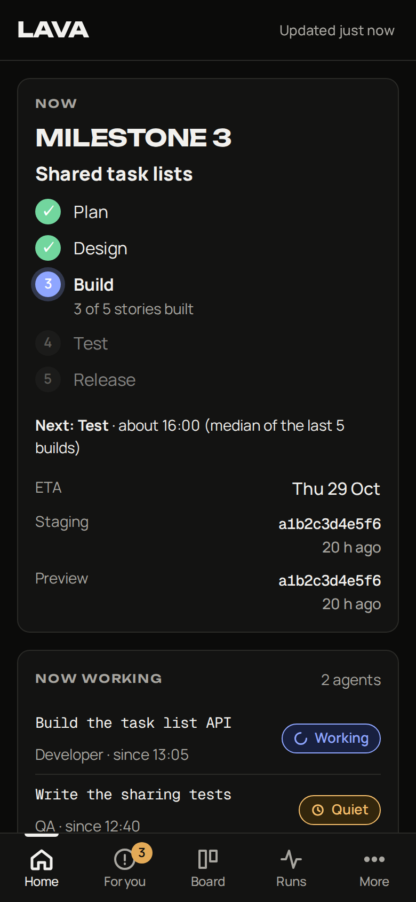
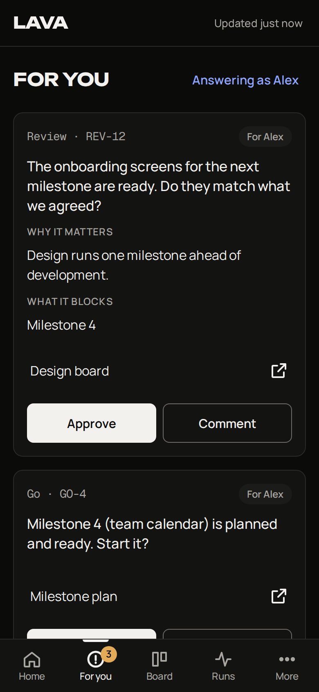
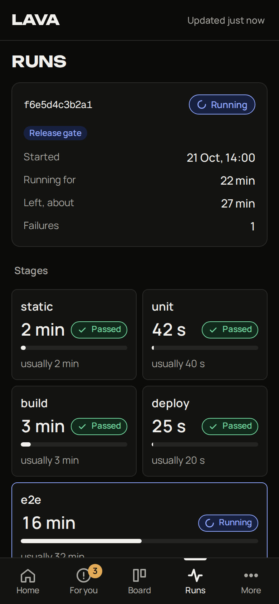
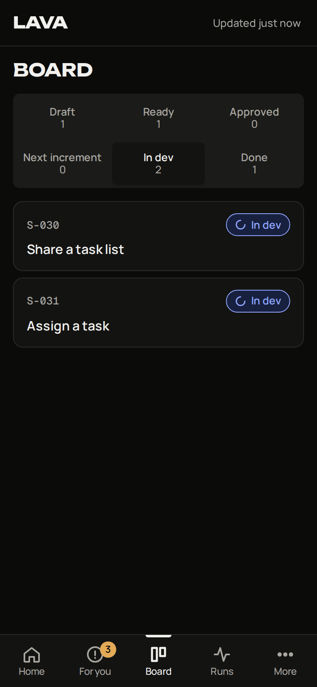
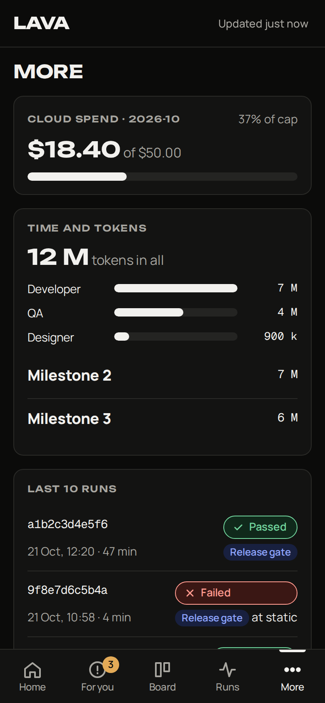

# LAVA

LAVA is an installable web app (a PWA) for phones and desktops. It shows the people who own a project what the team
is doing right now and asks them for the decisions the team is waiting on. Questions, reviews and go/no-go requests
come with a suggested answer, so a decision can take one tap, even from the notification. It uses Web Push.

It was built for a small team of developers (people or AI agents) working for one or two owners. It reads a few JSON
files that your own tooling writes, so it works with any process, CI system or agent framework.

| Home | For you | Runs | Board | More |
|---|---|---|---|---|
|  |  |  |  |  |

The screenshots show the sample data in `examples/inputs/`. Light mode: `docs/screenshots/*-light.png`.

## What it shows

- **Home:** the current milestone and its stage, which build runs in each environment, who is working on what, the open
  requests, the pipeline run, today's timeline, and spend against a cap.
- **For you:** questions, reviews and go requests, each with why it matters, what it blocks, links, and a suggestion to
  accept. Below that is the history of closed requests with the answers and the decision.
- **Board:** stories by status. Tap a story to see its journey steps.
- **Runs:** the current pipeline run as stage blocks with their times and failures, then the recent runs.
- **More:** tokens by role and by period, settings (who you are, notifications, font, theme) and your links.

## Quick start

You need Docker with Compose v2. You don't need Node, npm, make, or a build step.

```bash
docker compose up -d --build
# open http://127.0.0.1:8080
```

This starts two containers from one small image (128 MB memory limit each):

- `api` serves the web app and the API, and sends push notifications.
- `collector` reads the input files every 60 s and writes `board.json`.

The default setup reads the sample inputs in `examples/inputs/` and the sample config `lava.config.example.json`.
Stop it with `docker compose down`. Add `-v` to also delete the data volume.

To check the app without the API, add `?sample` to the URL. It then loads `web/sample/board.json` and
`web/sample/config.json`.

## Configuration

1. Copy `lava.config.example.json` to `lava.config.json` and edit it.
2. Copy `.env.example` to `.env`, and set `LAVA_CONFIG_FILE=./lava.config.json` and `LAVA_INPUTS` to the folder
   where your tooling writes the input files.
3. Generate push keys once with `node scripts/vapid-keys.mjs >> .env`. Without Node on the host, use
   `docker compose run --rm --no-deps api node scripts/vapid-keys.mjs >> .env`.
4. Run `docker compose up -d --build`.

| Key in `lava.config.json` | Meaning |
|---|---|
| `appName`, `description` | The name in the header and the tab title |
| `people` | `[{name, role}]`: who can answer. The app asks each device who is answering and offers only these names. |
| `links` | `[{label, href}]`: shown under More |
| `theme` | `accentLight`, `accentDark` (hex colours) |
| `sources.needsYou` | JSON file with the open requests (required to ask anything) |
| `sources.status` | JSON file: the "now" card, stories, agents, timeline, spend (optional) |
| `sources.pipeline` | JSON file: the current run and the recent runs (optional) |
| `sources.tokens` | JSON Lines token journal (optional) |
| `dataDir` | Where LAVA keeps its own files (default `/data`, a Docker volume) |
| `collector.intervalS` | How often the collector runs (default 60) |
| `push.subject` | The VAPID contact (`mailto:` or `https:` URL) |

| Environment variable | Meaning |
|---|---|
| `LAVA_VAPID_PUBLIC`, `LAVA_VAPID_PRIVATE`, `LAVA_VAPID_SUBJECT` | Web Push keys (keep them in `.env` only) |
| `LAVA_CONFIG_FILE`, `LAVA_INPUTS` | Host paths that compose mounts as the config and the inputs folder |
| `LAVA_BIND`, `LAVA_HOST_PORT` | Where the app listens on the host (default `127.0.0.1:8080`) |
| `LAVA_TEST=1` | Test mode for the whole API (see below) |
| `LAVA_DATA`, `LAVA_PORT`, `LAVA_CONFIG`, `LAVA_SOURCE_*`, `LAVA_COLLECT_INTERVAL_S` | Overrides inside the container |

The input formats are documented in [docs/how-it-works.md](docs/how-it-works.md), with JSON schemas in
`docs/schemas/`.

## How answers flow back

LAVA does not act on an answer. Every answer or accepted suggestion is appended as one JSON line to
`<data>/answers.jsonl`:

```json
{"id":"ans-mvjccl96-8e25c8","questionId":"Q-031","who":"Sam","kind":"accept","text":"Follow the user's locale ...","at":"2026-10-22T09:31:02Z"}
```

Your own process (a person, a script, or an agent) reads that file, records the decision wherever you keep decisions,
and removes the item from the needs-you file. It can also add the item to `history[]` with a `decision`. On the next
collector run, the request moves to the history in the app.

- `answers.jsonl` is **append-only**. No code in LAVA rewrites, truncates or deletes it.
- Read it with `docker compose exec api cat /data/answers.jsonl`, or mount `/data` as a host folder.
- `GET /api/answers?questionId=Q-031` returns the answers for one request.

## Notifications

The collector adds a notification to `<data>/push-outbox.jsonl` in these cases: when a new request appears, when a
pipeline run goes from running to pass or fail, and when the first environment gets a new build. The API sends each new
line as Web Push to every subscribed device. The very first collector run sends nothing, so an install doesn't start
with a burst of notifications. Subscriptions are kept per device, and a device is dropped only when the push service
answers 404 or 410. To send one by hand:
`docker compose exec api node api/send.mjs "Title" "Body" [/#needs/ID]`.

## Test mode

Add `?test=1` to any API request, or to the app URL, or start the API with `LAVA_TEST=1`. Test mode writes to
`<data>/test/`, which has its own `answers.jsonl` and `subscriptions.json`. It forces the identity `Test`, and the
collector ignores those answers. Use it for automated tests so they never write to the real log.

## Security: read this before you publish it

- **LAVA has no sign-in.** Identity is only the name the person picks on each device. The API checks that the name is
  one of the configured people and that an `onlyWho` item is accepted only by that person. Anyone who can reach
  the URL can read the board and answer as anyone.
- **Always put it behind an access layer** before it leaves localhost. Use Cloudflare Access, an SSO or OAuth proxy,
  a VPN, or at least HTTP basic auth on a reverse proxy with HTTPS. Web Push and installation need HTTPS anyway.
- The input is checked and capped: bodies are at most 8 KB, answers at most 2000 characters, and there are at most 30
  writes a minute. Links must be `http(s)` or relative. The containers run read-only as a non-root user with memory
  limits. By default the port binds to `127.0.0.1` only.
- Secrets (the VAPID private key) belong only in `.env`, which git ignores. `answers.jsonl` and `subscriptions.json`
  hold personal data, so keep the data volume private.

## Repository layout

```
api/          server.mjs (API + static app), push.mjs (VAPID + aes128gcm, node:crypto only), store.mjs, config.mjs, send.mjs
collector/    collect.mjs (inputs -> board.json + push outbox)
web/          index.html, app.js, app.css, sw.js, manifest, icons, fonts (with their licences), sample/
scripts/      vapid-keys.mjs, make-icons.mjs
examples/     inputs/ (neutral sample data)
docs/         how-it-works.md, schemas/, screenshots/
```

When you change files in `web/`, bump `VERSION` in `web/sw.js` so that installed apps pick up the new shell.

## Licence

Licence: to be chosen by the owner. Until a `LICENSE` file is added, no licence is granted. The bundled fonts keep
their own licences (SIL Open Font License), which are in `web/fonts/`.
