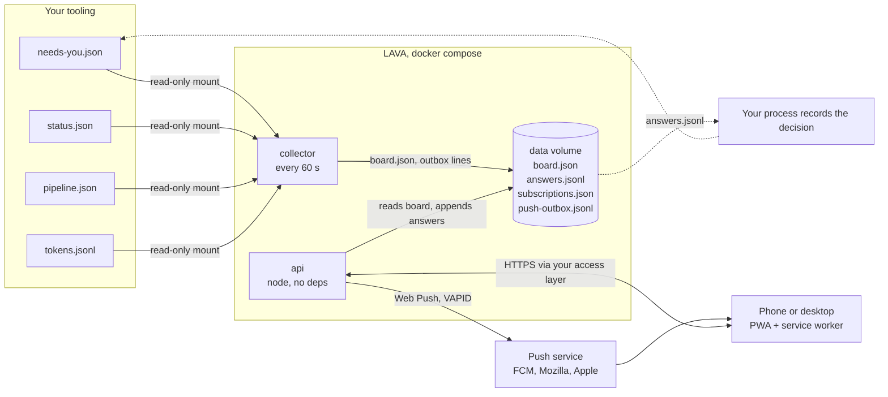

# How LAVA works

## Architecture



In plain text:

```
your tooling  --writes-->  inputs/*.json  --read by-->  collector  --writes-->  data/board.json
                                                                   --appends-> data/push-outbox.jsonl
phone  --GET /api/board------------------------------------------>  api  --reads--> data/board.json
phone  --POST /api/answers--------------------------------------->  api  --appends-> data/answers.jsonl
api    --every 10 s: new outbox lines as Web Push---------------->  push service --> phone
your process  --reads data/answers.jsonl, records the decision, removes the item from needs-you.json
```

## Data formats

All inputs are optional. A missing file means that part of the app stays empty. A broken file is listed under
More > "Collector notes". Schemas are in `docs/schemas/`, and working examples are in `examples/inputs/`.

### needs-you.json (`sources.needsYou`)

```json
{
  "items": [
    { "id": "Q-031", "kind": "question", "who": "Sam", "title": "Week start day",
      "question": "Should the week start on Monday for everyone?", "why": "...", "blocks": "Story S-041",
      "suggestion": "Follow the user's locale.", "links": [{ "label": "Spec", "href": "https://..." }] },
    { "id": "GO-db-7", "kind": "go", "who": "Sam", "onlyWho": "Sam", "question": "Apply the database change?" }
  ],
  "history": [ { "id": "Q-027", "question": "...", "resolvedAt": "...", "decision": "Decision 14", "decisionUrl": "https://..." } ],
  "now": { "eta": "2026-10-29" }
}
```

- `kind` sets the buttons. `question` gets "Accept suggestion" (when there is a suggestion) and "Answer". `review` gets
  "Approve" and "Comment". `go` gets "Start" and "Not yet".
- When an id leaves `items`, the collector moves it to the history, with the time it disappeared and the answers from
  `answers.jsonl`. An entry in `history[]` overrides that, and adds the `decision`.

### status.json (`sources.status`)

This file holds the `now` card (title, theme, status line, ETA, `environments[]`, an optional `stepper`), `stories[]` for
the Board, `agents.now[]` for "Now working", `timeline[]`, `nightly`, `quick[]`, and `spend {label, amount, cap, unit,
period}`. See `docs/schemas/status.schema.json`.

### pipeline.json (`sources.pipeline`)

```json
{ "pipeline": { "runId": "run-0142", "build": "f6e5d4c3b2a1", "state": "running", "startedAt": "...", "elapsedS": 1310, "etaS": 2900,
    "stages": [{ "name": "unit", "status": "pass", "seconds": 42, "expectedS": 40 }],
    "failures": [{ "stage": "e2e", "owner": "Developer", "id": "T-118", "test": "...", "reason": "..." }] },
  "runs": [{ "runId": "run-0141", "build": "a1b2c3d4e5f6", "result": "pass", "seconds": 2810, "startedAt": "..." }] }
```

Your CI writes this file. You can write it once at the end of a run, or after every stage for a live view.

### tokens.jsonl (`sources.tokens`)

The file has one line per unit of work: `{"at": "...", "role": "Developer", "tokens": 4200000, "period": "Milestone 3"}`.
The collector adds up the tokens by role and by period. For AI agent teams this shows where the effort goes. Any
other number, such as hours, works too.

### LAVA's own files (in the data volume)

| File | Written by | Notes |
|---|---|---|
| `board.json` | collector | What the app shows. Written atomically. |
| `collector-state.json` | collector | When each request was first seen and closed, and the last pipeline state and build |
| `push-outbox.jsonl` / `.offset` | collector / api | Notifications to send, and how far the API has sent |
| `answers.jsonl` | api | **Append-only.** One answer per line (`docs/schemas/answer.schema.json`) |
| `subscriptions.json` | api | One entry per device endpoint |
| `test/` | api | The same files for test mode |

## API

| Method and path | What it does |
|---|---|
| `GET /api/health` | `ok` |
| `GET /api/config` | The public config: app name, people, links, theme. Never paths or keys. |
| `GET /api/board` | `board.json`, or `{"waiting": true}` before the first collector run |
| `POST /api/answers` | `{questionId, who, kind: "accept" or "answer", text}` returns 201 with the record. It answers 422 for an unknown id, a person not in the config, empty answer text, or an `onlyWho` mismatch. |
| `GET /api/answers?questionId=` | The answers already sent |
| `GET /api/vapid` | `{publicKey}`, or 503 when push is not set up |
| `POST /api/subscriptions` | `{endpoint, keys: {p256dh, auth}, who}` (the endpoint must be `https`) |
| `DELETE /api/subscriptions` | `{endpoint}` |
| anything else | The static app from `web/` |

Add `?test=1` to any route to use test mode. Writes (answers and subscriptions) share a limit of 30 a minute.

## Push

`api/push.mjs` implements Web Push with only `node:crypto`. It signs a VAPID ES256 JWT (RFC 8292) and encrypts the
message with `aes128gcm` (RFC 8291 and RFC 8188). The payload is `{title, body, url, tag, actions, questionId, kind,
suggestion}`. When the person taps "Accept suggestion", "Approve" or "Start" in the notification, the service worker
posts the answer directly, using the name stored on that device. If the device has no name yet, the app opens and
asks for one.

## Service worker and offline use

- The shell (HTML, CSS, JS, icons, fonts) is cache-first and refreshed in the background. Bump `VERSION` in
  `web/sw.js` on every release.
- `/api/board` is network-first. The last copy is kept, so the app still opens offline and shows "Offline" in the
  header.
- Other `/api/` calls always go to the network. While offline, answers fail with a clear message, and nothing is
  queued.

## Install on a phone

- **Android (Chrome, Samsung Internet, Edge):** open the URL. Choose "Install" in the app (Home or More) or
  "Add to Home screen" in the browser menu. Then turn notifications on under More > Notifications.
- **iPhone and iPad (iOS 16.4 or later):** open the URL in Safari and choose Share > "Add to Home Screen". Open LAVA from
  the home screen, then turn notifications on under More. Push works on iOS only for the installed app.
- **Desktop (Chrome, Edge):** use the install icon in the address bar. Notifications work from the browser too.

All of this needs HTTPS on a real hostname. `http://127.0.0.1` also works for local tests.

## Icons and fonts

`node scripts/make-icons.mjs` redraws the PNG icons with no dependencies. The fonts are self-hosted (Manrope,
Unbounded, Space Grotesk, Zilla Slab, IBM Plex Sans and Geist Mono), and each one has its licence file next to it.
The app loads nothing from a CDN.
